# 可攜式、可換模型的股票估值系統（A 組 FCFF 框架）

- 版本：1.1
- 日期：2026-11-11（亞洲／澳門時間，UTC+8）
- 語言：繁體中文
- 倉庫：[https://github.com/capturesir/stock-valuation](https://github.com/capturesir/stock-valuation)
- 本系統把既有 A 組 FCFF 框架（方法 A 折現率、五情境、可驗證 Excel、B 組相容訊號檔）打包成可在 **Windows、macOS 與 Linux** 本機運行、並改接其他大語言模型（含本地 OpenAI 相容伺服器）的程式集。
- **本系統產出不構成投資建議。** 官方理論價由本機 Python 引擎按已列來源與假設計算，不是模型的記憶或心算。訊號檔是研究用輸出，不是下單指令。

完整作業規則見 [`docs/估值框架作業手冊.md`](docs/估值框架作業手冊.md)。B 組相容訊號格式見 [`docs/signals-format.md`](docs/signals-format.md)。本 README 說明如何從 GitHub 部署，以及如何用網頁或命令列使用本系統。

---

## 1. 系統做什麼

把一隻股票的估值分成兩類：

1. **首次估值**（`cases/<代號>/` 還沒有通過驗證的模型規格與 state）：上網抓真實市價、財報、無風險利率、一致預期與目標價區間（若有）、披露易或 SEC 公告；用規則後備（或 LLM API）寫逐年假設；**理論價必須由 `src/engine/fcff_engine.py` 算出**；再獨立驗證、出 Excel 與繁中說明。
2. **已有模型之後的重跑**：若沒有新業績／新指引／新融資，只需更新市價與必要的 Rf，重跑引擎，幾乎不耗 AI 用量。若 `check-filings` 發現比上次估值更新的年報、季報、中期、全年業績或盈警／盈利預告，則應重跑並修訂假設。

任何「需要判斷」的步驟（讀財報、提案假設、擷取投行數字）都經由 **單一 API 客戶端** `src/llm/client.py`（OpenAI 相容的 `/v1/chat/completions`）。沒有金鑰、沒有 `base_url`、或請求失敗時，自動改用規則後備，並在結果寫上 `assumption_source = rules_fallback`。**沒有 LLM 也能跑完整個估值**（本次 1830.HK 與 NVDA 的驗證就是如此）。

官方理論價一律以「摘要」頁、calc JSON 與 `verify_fcff` 為準。「計算」頁是 Excel／網頁用公式即時重算，用來核對，兩者應相符（容許 ±0.5%）。

本系統**不會**自動把代號寫入正式關注名單。臨時估值預設不進關注名單。若要產出與 B 組自動交易系統相容的訊號檔，須另外執行 `export-signals` 或在網頁按「匯出訊號」，預設只寫到本套件的 `out/signals.json`。

目前驗證版的完整規格只內建 **NVDA** 與 **1830.HK**（`src/pipeline/name_specs.py`）。為其他股票做首次估值，必須先按手冊取真實來源並新增規格，不可讓模型用訓練記憶填數字。

---

## 2. 從 GitHub 部署

本說明同時適用於 **Windows、macOS 與 Linux**。三種系統都可以 `git clone` 後在本機運行；差異只在安裝 Python、啟動虛擬環境、複製設定檔，以及設定環境變數的寫法。虛擬環境啟動成功後，後面的 `python -m ...`、`pip`、`pytest` 指令在三個系統都相同。

需要：Git、Python 3.11 或更新（本機驗證環境為 3.13）、可連線外網（抓 Yahoo、SEC、披露易、債券利率等）。可選：LibreOffice（對 Excel 做公式重算核對，不是通過驗證的必要條件）。

先確認 Python 版本：

| 系統 | 檢查指令 |
| --- | --- |
| Windows | `py -3 --version` 或 `python --version` |
| macOS | `python3 --version` |
| Linux | `python3 --version` |

若尚未安裝：Windows 可到 [python.org](https://www.python.org/downloads/windows/) 安裝，並勾選 “Add python.exe to PATH”；macOS 可用官網安裝檔或 `brew install python`；Linux 用發行版套件（例如 `sudo apt install python3 python3-venv python3-pip`）。三個系統都需要已安裝 [Git](https://git-scm.com/downloads)。

### 2.1 複製倉庫並安裝

請選你正在使用的系統，整段複製執行。安裝完成後，以後每次使用都要先進入目錄並啟動虛擬環境。

**Windows（PowerShell）：**

```powershell
git clone https://github.com/capturesir/stock-valuation.git
cd stock-valuation
py -3 -m venv .venv
.\.venv\Scripts\Activate.ps1
pip install -r requirements.txt
copy config.example.yaml config.yaml
python -m pytest tests/ -q
```

若啟動虛擬環境時出現「無法載入，因為在此系統上禁止執行指令碼」，先在同一視窗執行一次（只改目前使用者，不必用系統管理員）：

```powershell
Set-ExecutionPolicy -Scope CurrentUser RemoteSigned
```

然後再執行 `\.venv\Scripts\Activate.ps1`。若你使用命令提示字元（CMD）而不是 PowerShell：

```bat
git clone https://github.com/capturesir/stock-valuation.git
cd stock-valuation
py -3 -m venv .venv
.venv\Scripts\activate.bat
pip install -r requirements.txt
copy config.example.yaml config.yaml
python -m pytest tests/ -q
```

**macOS（Terminal，預設 zsh 即可）：**

```bash
git clone https://github.com/capturesir/stock-valuation.git
cd stock-valuation
python3 -m venv .venv
source .venv/bin/activate
pip install -r requirements.txt
cp config.example.yaml config.yaml
python -m pytest tests/ -q
```

若 `python3 -m venv` 提示缺少確保套件，先依提示安裝 Xcode Command Line Tools，或用 Homebrew 安裝 Python 後再試。

**Linux（bash 或 zsh）：**

```bash
git clone https://github.com/capturesir/stock-valuation.git
cd stock-valuation
python3 -m venv .venv
source .venv/bin/activate
pip install -r requirements.txt
cp config.example.yaml config.yaml
python -m pytest tests/ -q
```

測試通過即可使用。

> **注意**：`out/` 與 `cases/` 內的檔案同時是估值輸出，也是測試的比對基準。跑過一次真實估值（網頁或 CLI）之後，這些檔案會被覆寫，`python -m pytest tests/ -q` 會因為數值不再相同而失敗；要重跑測試，先 `git checkout -- out cases` 還原基準檔。測試會略過 `.venv`、`venv`、`config.yaml`、`.env` 這些本機檔案。

之後每次進入目錄，先啟動虛擬環境：

| 系統 | 啟動虛擬環境 |
| --- | --- |
| Windows PowerShell | `\.venv\Scripts\Activate.ps1` |
| Windows CMD | `.venv\Scripts\activate.bat` |
| macOS / Linux | `source .venv/bin/activate` |

啟動成功後，命令列前面通常會出現 `(.venv)`。此時請用 `python`（不是未啟動時的 `python3`／`py -3`）。

### 2.2 設定注意

- **不要把 API 金鑰、收件或寄件信箱、SMTP 密碼寫進 `config.yaml`，也不要提交 `.env`。** 語言模型金鑰用 `LLM_API_KEY`（見第 6 節）；電郵用第 2.4 節的環境變數。`config.yaml` 已列入 `.gitignore`；請從 `config.example.yaml` 複製一份在本機使用。
- 沒有設定語言模型也可以估值，系統會走規則後備。
- 沒有設定電郵也可以估值，系統只在本機寫出 Excel 與說明，不會寄信，也沒有預設的私人信箱。
- 本介面預設只綁定本機 `127.0.0.1:8765`，不會對外開放。
- 說明裡的路徑以正斜線寫（例如 `out/signals.json`），在 Windows、macOS、Linux 的 Python 與 Git 都可使用。

### 2.3 啟動網頁（建議的使用方式）

以下指令在虛擬環境已啟動的前提下，Windows、macOS、Linux 都相同：

```bash
python -m src.web.app
```

也可以：

```bash
python -m src.web
# 或
python -m uvicorn src.web.app:app --host 127.0.0.1 --port 8765
```

以瀏覽器開啟 [http://127.0.0.1:8765/](http://127.0.0.1:8765/)。主機與埠可用環境變數 `VALUATION_WEB_HOST`、`VALUATION_WEB_PORT` 更改（寫法見第 6 節）。**CLI 原指令、旗標、預設值與結束碼不受網頁影響。**

### 2.4 電郵設定（可選）

電郵不是必須步驟。未設定收件信箱、寄件信箱或 SMTP 時，系統只在本機產出檔案，**不會寄信**，也**沒有**內建的私人信箱。若你要在估值完成後把 Excel 寄給自己，請在本機設定下列環境變數（環境變數優先於 `config.yaml`；**密碼只能用環境變數**，不要寫進設定檔或提交到 Git）：

| 變數 | 含義 |
| --- | --- |
| `VALUATION_REPORT_TO` | 收件信箱（你自己要接收報告的地址） |
| `VALUATION_REPORT_FROM` | 寄件信箱（通常與 SMTP 登入帳號相同） |
| `VALUATION_SMTP_HOST` | SMTP 主機，例如 Gmail 為 `smtp.gmail.com` |
| `VALUATION_SMTP_PORT` | 埠，常見為 `587` |
| `VALUATION_SMTP_USER` | SMTP 登入帳號；若留空，會改用寄件信箱 |
| `VALUATION_SMTP_PASSWORD` | SMTP 密碼或應用程式密碼 |
| `VALUATION_SMTP_STARTTLS` | 預設啟用；若不需要 STARTTLS，設為 `0` |

請填你自己的地址，不要使用倉庫說明裡的任何範例當真實信箱，也不要把別人的私人信箱寫進去。

虛擬環境已啟動後，三種系統的寫法如下（視窗關閉後失效；把範例換成你自己的信箱與密碼）：

**Windows（PowerShell）：**

```powershell
$env:VALUATION_REPORT_TO="you@example.com"
$env:VALUATION_REPORT_FROM="you@example.com"
$env:VALUATION_SMTP_HOST="smtp.gmail.com"
$env:VALUATION_SMTP_PORT="587"
$env:VALUATION_SMTP_USER="you@example.com"
$env:VALUATION_SMTP_PASSWORD="your-app-password"
python -m src.pipeline.cli run --ticker NVDA --email
```

**Windows（CMD）：**

```bat
set VALUATION_REPORT_TO=you@example.com
set VALUATION_REPORT_FROM=you@example.com
set VALUATION_SMTP_HOST=smtp.gmail.com
set VALUATION_SMTP_PORT=587
set VALUATION_SMTP_USER=you@example.com
set VALUATION_SMTP_PASSWORD=your-app-password
python -m src.pipeline.cli run --ticker NVDA --email
```

**macOS / Linux：**

```bash
export VALUATION_REPORT_TO="you@example.com"
export VALUATION_REPORT_FROM="you@example.com"
export VALUATION_SMTP_HOST="smtp.gmail.com"
export VALUATION_SMTP_PORT="587"
export VALUATION_SMTP_USER="you@example.com"
export VALUATION_SMTP_PASSWORD="your-app-password"
python -m src.pipeline.cli run --ticker NVDA --email
```

若估值已經做完，只要補寄已有輸出：

```bash
python -m src.pipeline.cli send-report --ticker NVDA
python -m src.pipeline.cli send-report --ticker 1830.HK --date 2026-11-11
```

使用 Gmail 時，請用你自己的 Gmail 作為寄件信箱，並在 Google 帳戶建立「應用程式密碼」；不要把倉庫作者或其他人的信箱寫進去。其他郵件服務則改成該服務的 SMTP 主機與埠。本機網頁目前提供下載 Excel，寄信仍經上述命令列設定。

若加了 `--email` 或執行 `send-report` 但設定不齊全，指令會說明缺少哪些變數並以結束碼 `4` 離開，本機檔案仍會保留。

## 3. 圖文教學：本機網頁怎麼用

網頁與 CLI 的 `run`／`check-filings` 對應；**查詢不會自動開始估值**，必須再按「估值」。

使用流程：

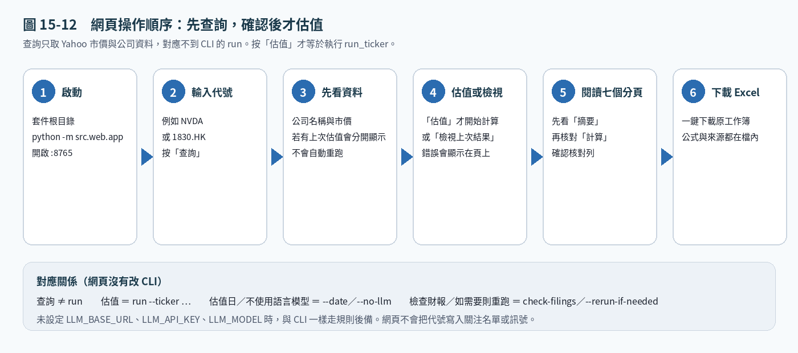

### 3.1 首頁

開啟後會看到代號輸入欄。先輸入股票代號，再按「查詢」。

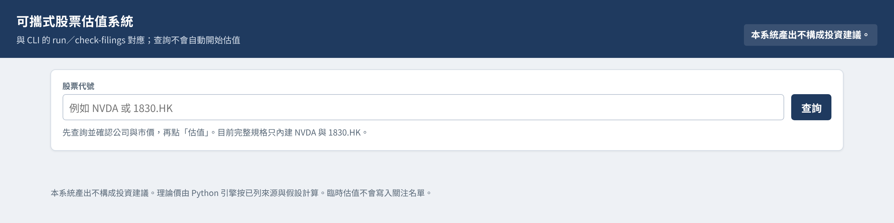

### 3.2 查詢美股與港股

查詢成功後，頁面會顯示公司名稱、貨幣與市價等資料，此時**尚未**計算理論價。確認是你要的股票，再按「估值」。估值過程若有問題，錯誤會直接顯示在頁面上。

NVIDIA（`NVDA`）查詢結果示例：

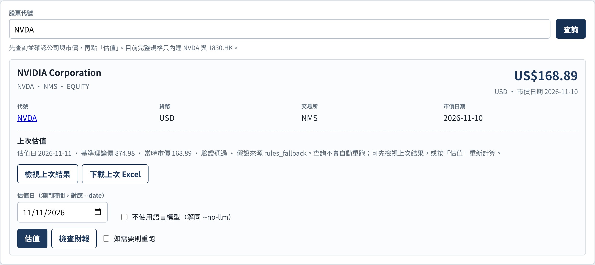

完美醫療（`1830.HK`）查詢結果示例：

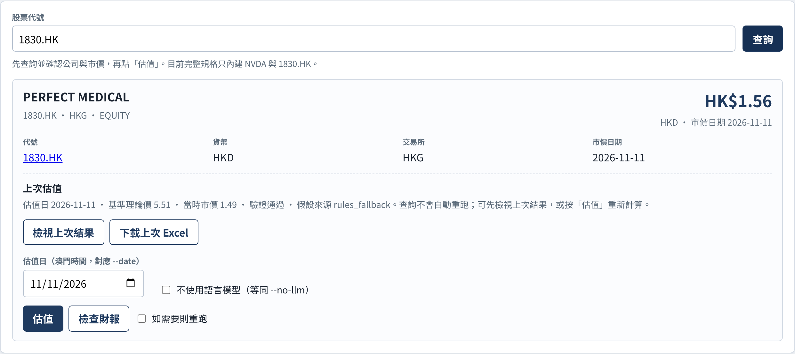

代號不存在或無法取得報價時，頁面會顯示錯誤，不會開始估值：

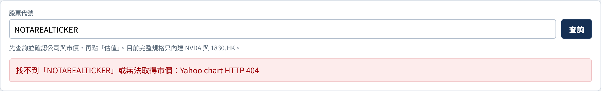

「檢查財報」對應 `check-filings`；勾選「如需要則重跑」則對應 `--rerun-if-needed`。估值日、「不使用語言模型」分別對應 `--date`、`--no-llm`。

若這個代號已有最新 Excel，頁面會出現「上次估值」，可先檢視或下載，但仍須再按「估值」才會重跑。

### 3.3 估值完成後的分頁

完成後，網頁會把 Excel 的七個分頁呈現出來，並可一鍵「下載 Excel」。各分頁用途如下：

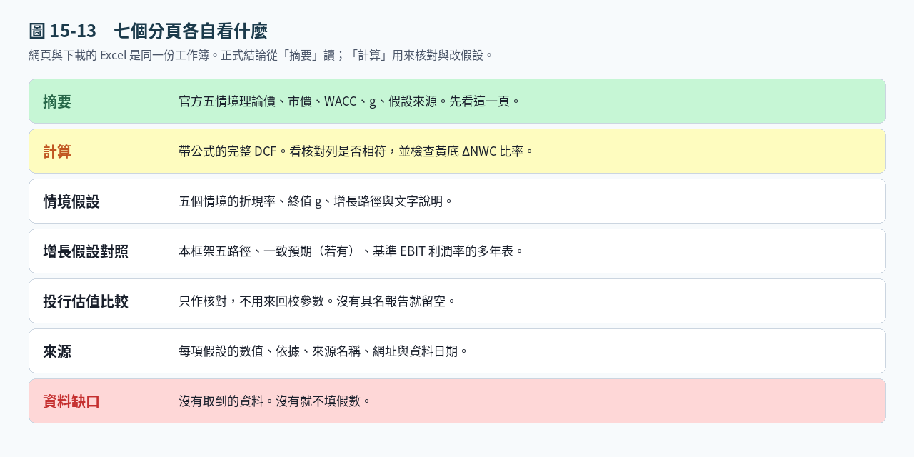

| 分頁 | 看什麼 |
| --- | --- |
| 摘要 | **官方理論價**（基準）與五情境、市價、WACC、驗證結果 |
| 計算 | 用試算表公式即時重算，並與 JSON 官方理論價核對 |
| 情境假設 | 悲觀／基準／樂觀／靜態／9%靜態的假設對照 |
| 增長假設對照 | 不同估值法下未來多年的增長假設 |
| 投行估值比較 | 只填本次真實抓到的來源；沒有就留空，禁止捏造 |
| 來源 | 所有數據來源 |
| 資料缺口 | 取不到的資料與已試來源 |

NVIDIA 估值完成後的分頁示意：

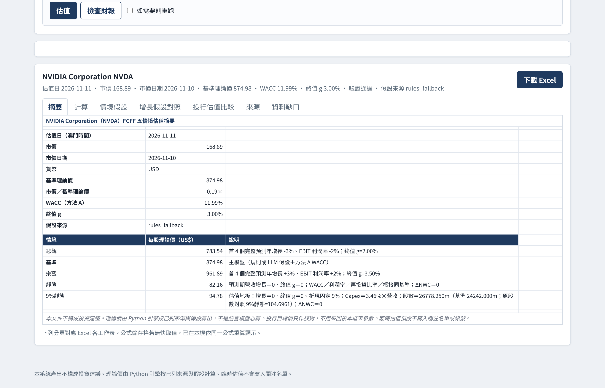

摘要頁示例（官方基準理論價 US$874.98）：

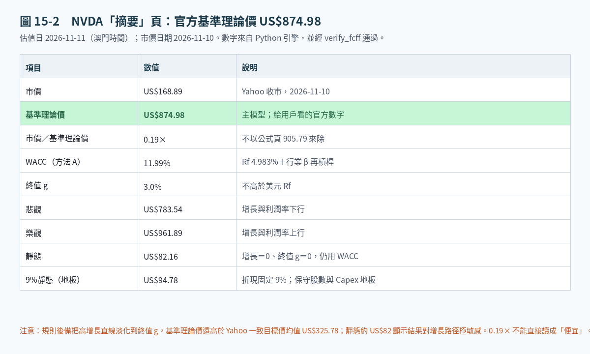

語言模型仍只讀環境變數 `LLM_BASE_URL`、`LLM_API_KEY`、`LLM_MODEL`；未設定時與 CLI 相同，改用規則後備。

---

## 4. 如何閱讀理論價：「摘要」才是官方數字

系統只有**一個**官方理論價：寫在「摘要」、calc JSON（`fair_value_per_share`）以及 `verify_fcff` 的結果。請以此為準。

「計算」頁是同一套假設的公式重算，用來交叉核對，不是第二種估值方法。頁面底部有「核對」列：公式價 ÷ JSON 官方價 − 1，容許差距 ±0.5%。核對結果應為「相符」。

2026-11-11 晚間已修正一項匯出錯誤：舊版「計算」頁在 `base_year` 沒有寫入 `nwc_rate` 時，會靜默改用 5% 的 ΔNWC 比率，以致公式價與官方理論價不一致。現在會改用引擎實際使用的 ΔNWC 比率（並在新的估值 JSON 寫入該比率）。**官方理論價沒有因此改變。**

修正後的 NVIDIA「計算」頁示例：公式價 US$875.10，JSON 官方價 US$874.98，差距 0.0144%，核對相符。

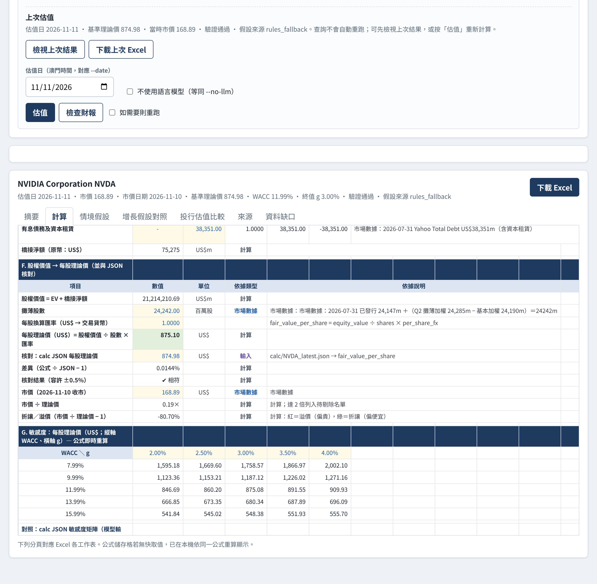

閱讀建議：

- 對外引用、寫報告、產訊號，一律用「摘要」的基準理論價（本例為 US$874.98）。
- 「計算」頁用來檢查假設是否被正確搬進試算表；若核對不相符，不要把公式價當成第二個官方價，應先查 ΔNWC 與其他輸入是否與 JSON 一致。
- 極小的殘差（例如本例 0.0144%）來自年度切割／四捨五入，只要在 ±0.5% 內即可視為相符。

---

## 5. 命令列使用

在本目錄、虛擬環境已啟動的前提下，以下指令在 Windows、macOS、Linux 都相同：

```bash
# 為一隻股票估值（首次或重跑）
python -m src.pipeline.cli run --ticker NVDA
python -m src.pipeline.cli run --ticker 1830.HK
python -m src.pipeline.cli run --ticker NVDA --date 2026-11-11 --no-llm

# 檢查自上次估值以來是否有新財報（美國：SEC submissions；香港：披露易）
python -m src.pipeline.cli check-filings --ticker NVDA
python -m src.pipeline.cli check-filings --ticker 1830.HK

# 若偵測到更新檔，自動重跑
python -m src.pipeline.cli check-filings --ticker NVDA --rerun-if-needed

# 從已有估值輸出，匯出 B 組相容訊號檔（見第 9 節）
python -m src.pipeline.cli export-signals --ticker NVDA --ticker 1830.HK

# 可選：按第 2.4 節的本機設定寄出報告（未設定則不要加 --email）
python -m src.pipeline.cli run --ticker NVDA --email
python -m src.pipeline.cli send-report --ticker NVDA
```

結束碼：`0` 正常（估值驗證通過，檢查結果為不必重跑，訊號匯出成功，或電郵已寄出）；`2` 估值驗證失敗或訊號檔驗證失敗；`10` 需要重跑；`3` 檢查被攔截或出錯；`4` 已要求寄信但設定不齊全或寄送失敗（本機檔案仍保留）。

產出位於 `out/YYYY-MM-DD_<代號>/`：JSON、Excel、繁中說明、假設 CSV。

---

## 6. 如何改接其他模型（雲端或本地）

**不要把 API 金鑰寫進 `config.yaml`。** 一律用環境變數：

| 變數 | 含義 |
| --- | --- |
| `LLM_BASE_URL` | OpenAI 相容根路徑，須含 `/v1` 或該伺服器的相容前綴（客戶端會呼叫 `{base_url}/chat/completions`） |
| `LLM_API_KEY` | 金鑰。本地伺服器若不需要金鑰，可留空 |
| `LLM_MODEL` | 模型名稱，例如 `gpt-4o-mini`、`llama3.1`、`qwen2.5` |

`config.yaml` 裡的 `llm.base_url`／`llm.model` 只是預設；環境變數優先。

設定環境變數的寫法依系統而異（金鑰不要寫進檔案、不要提交到 Git）：

| 系統 | 寫法（以 `LLM_MODEL` 為例；視窗關閉後失效） |
| --- | --- |
| Windows PowerShell | `$env:LLM_MODEL="gpt-4o-mini"` |
| Windows CMD | `set LLM_MODEL=gpt-4o-mini` |
| macOS / Linux | `export LLM_MODEL="gpt-4o-mini"` |

**雲端（OpenAI 相容）例子：**

Windows PowerShell：

```powershell
$env:LLM_BASE_URL="https://api.openai.com/v1"
$env:LLM_API_KEY="sk-..."          # 不要提交到檔案庫
$env:LLM_MODEL="gpt-4o-mini"
python -m src.pipeline.cli run --ticker NVDA
```

Windows CMD：

```bat
set LLM_BASE_URL=https://api.openai.com/v1
set LLM_API_KEY=sk-...
set LLM_MODEL=gpt-4o-mini
python -m src.pipeline.cli run --ticker NVDA
```

macOS / Linux：

```bash
export LLM_BASE_URL="https://api.openai.com/v1"
export LLM_API_KEY="sk-..."          # 不要提交到檔案庫
export LLM_MODEL="gpt-4o-mini"
python -m src.pipeline.cli run --ticker NVDA
```

Azure 相容端點通常把 `base_url` 設成該資源的 chat completions 根路徑，並把金鑰放在 `LLM_API_KEY`（本客戶端送 `Authorization: Bearer`）。若你的閘道用其他標頭，請在 `src/llm/client.py` 集中修改，不要在其他模組另寫 HTTP。

**本地 OpenAI 相容伺服器例子**（Ollama 須先啟用 OpenAI 相容端點；LM Studio／llama.cpp／vLLM 常見埠為 1234 或 8000）。通常不需要 `LLM_API_KEY`。

Windows PowerShell：

```powershell
$env:LLM_BASE_URL="http://127.0.0.1:11434/v1"
$env:LLM_MODEL="llama3.1"
python -m src.pipeline.cli run --ticker 1830.HK
```

macOS / Linux：

```bash
export LLM_BASE_URL="http://127.0.0.1:11434/v1"
export LLM_MODEL="llama3.1"
python -m src.pipeline.cli run --ticker 1830.HK
```

Windows CMD 則用 `set LLM_BASE_URL=http://127.0.0.1:11434/v1` 與 `set LLM_MODEL=llama3.1`。若改用 LM Studio 等，把位址改成 `http://127.0.0.1:1234/v1` 即可。

客戶端行為：逾時與重試；若伺服器支援 `response_format=json_object` 會優先使用，失敗則改解析 fence 中的 JSON。解析不到或 HTTP 失敗時，**不會中斷估值**，改走規則後備並記錄錯誤。

強制不用 LLM：

```bash
python -m src.pipeline.cli run --ticker NVDA --no-llm
```

AI 在本系統中只負責判斷（讀財報、寫假設理由、比較投行資料、檢查資料是否足夠）。官方理論價一律由本機 Python 計算。換用不同 API 或本地模型，可能改變假設路徑，從而使理論價不同；但方法 A 的 WACC、折現、驗證與 Excel 數學不會因模型而改變。若要避免漂移，把假設鎖在規格／JSON 裡，只重跑腳本。

腳本與 API 的分工如下：

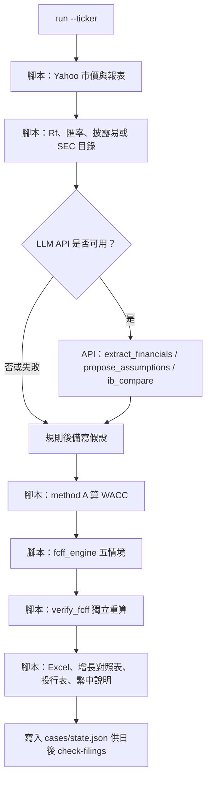

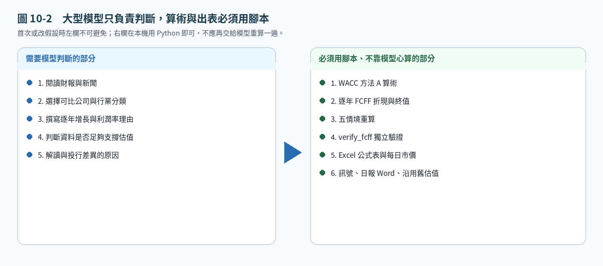

| 步驟 | 類型 |
| --- | --- |
| 市價、財務報表、Rf、Yahoo 共識與目標價區間、披露易公告清單、SEC submissions | 確定性腳本（`src/fetch/`） |
| 讀財報文字、提案逐年假設、從來源文本擷取具名投行目標價 | API（`src/llm/`＋`prompts/`） |
| WACC、FCFF 折現、五情境、驗證、Excel、增長表「本框架」各欄 | 確定性腳本，**禁止**用心算或模型直接給理論價 |
| 檢查新財報、決定是否重跑 | 確定性腳本（`src/filings/detect.py`） |
| 訊號檔的方向、信心與升幅 | 確定性腳本（`src/signals/`），見第 9 節 |

**所有數字必須來自來源，不是 LLM 的記憶。** 取不到就在 `data_gaps` 直寫「沒有取到」與已試來源。

---

## 7. 規則後備在 API 不可用時做什麼

| 項目 | 規則 |
| --- | --- |
| WACC | 只用 `method_a.py`（方法 A）＋當日抓到的 Rf。LLM **不准**算 WACC |
| 營收路徑 | 有 Yahoo 一致預期的年份用共識，其後把增長直線淡化到終值 g。沒有共識則用可核對的最近量化頂線（並標低信心）或最近報告增長，同樣淡化到 g |
| 利潤率 | 近期實際／已還原的營業利潤率，向多年平均淡化 |
| Capex | 有公司指引則用指引，否則用歷史現金 Capex／營收。9%地板＝max(3–5 年 PPE 折舊%，平均 Capex%)；HKFRS／IFRS 16 只用 PPE 折舊，不用含使用權的總 D&A |
| 悲觀／樂觀 | 跳過殘段後，首 4 個完整年增長 ±3 個百分點、利潤率 ±2 個百分點（可在規格裡改） |
| 靜態／9%靜態 | 增長 0、終值 g=0；9%靜態固定 9% 折現、Capex 地板、保守股數、ΔNWC=0 |
| 投行表 | 只填本次真實抓到的 Yahoo 目標價區間；具名券商僅在確實抓到來源文本時由 `ib_compare` 步驟填入，**禁止捏造** |

---

## 8. 新財報觸發重跑

`cases/<ticker>/state.json` 會記下上次估值所用的業績檔日期。

- **美股**：查 `https://data.sec.gov/submissions/CIK........json`（需 User-Agent）。比較最新 10-K、10-Q 或業績 8-K（item 2.02）的 `filingDate`。`www.sec.gov/Archives` 的 HTML 常見 HTTP 403（Cloudflare），**偵測以 data.sec.gov JSON 為準**；讀全文失敗時不要用記憶裡的舊 10-K 數字冒充最新。
- **港股**：先用披露易 `prefix.do` 把代號（例如 1830 → 01830）換成 `stockId`，再查 `titleSearchServlet.do`。把年報、中期、全年／中期業績、盈警／盈利預告、營運數據更新視為「相關檔」。若網站被攔截，指令會回 `CHECK_BLOCKED_OR_ERROR`，必須人手打開披露易或公司 IR。

例子：完美醫療已宣布 **2026-11-16** 召開董事會審批截至 2026-09-30 的中期業績。該日之後再跑 `check-filings --ticker 1830.HK`，若已刊登中期業績，應出現 `STATUS=RERUN_NEEDED`，並建議重跑（屆時可用真實 H1 營收取代本次的銷售合約代理）。

---

## 9. 交易訊號匯出（B 組相容，schema_version 1.0）

估值完成後，可另外匯出與 B 組自動交易系統相同格式的訊號檔，方便日後自行接上交易框架。完整欄位、計算規則與讀取方式見 [`docs/signals-format.md`](docs/signals-format.md)。模板與 JSON Schema 分別為 [`docs/signals_schema_v1.json`](docs/signals_schema_v1.json)、[`docs/signals.schema.json`](docs/signals.schema.json)。

預設寫到本套件的 `out/signals.json` 及日期副本 `out/signals/YYYY-MM-DD.json`。這是研究用訊號檔，不是投資建議，也不是下單指令。估值本身預設仍不會自動匯出。

```bash
# 從已有估值輸出匯出（可重複 --ticker，或用逗號分隔）
python -m src.pipeline.cli export-signals --ticker NVDA --ticker 1830.HK
python -m src.pipeline.cli export-signals --ticker NVDA,1830.HK --date 2026-11-11
python -m src.pipeline.cli export-signals --from-json out/2026-11-11_NVDA/NVDA_latest.json
python -m src.pipeline.cli export-signals --ticker NVDA --no-merge

# 估值驗證通過後才合併寫入 out/signals.json（預設關閉）
python -m src.pipeline.cli run --ticker NVDA --export-signals
```

本機網頁在估值完成或載入既有結果後，可「下載訊號 JSON」（只下載、不寫檔），或按「匯出訊號」才寫入 `out/signals.json`。

方向與信心由理論價相對市價的差距決定（基礎公式，與正式訊號檔相同）：升幅 ≥ 15% 為 `BUY`，≤ −15% 為 `SELL`，其餘為 `HOLD`。買／賣信心為 `min(90, 40 + round(|upside|))`，持有為 `max(0, 50 − round(|upside|))`。本套件不套用 A 組正式流程中額外的信心上限、資料缺口扣分或「是否啟用訊號」覆核閘門；若日後要自行加上，見格式說明。

以本次驗證為例（市價日期 2026-11-10）：

| 代號 | 方向 | 信心 | 升幅 | 理論價 | 市價 |
| --- | --- | --- | --- | --- | --- |
| NVDA | BUY | 90 | +418.1% | 874.98 美元 | 168.89 |
| 1830.HK | BUY | 90 | +269.8% | 5.51 港元 | 1.49 |

---

## 10. 目錄說明

```
stock-valuation/
  README.md
  requirements.txt
  config.example.yaml          # 複製為本機 config.yaml，不要提交金鑰
  docs/估值框架作業手冊.md
  docs/signals-format.md       # B 組相容訊號格式
  docs/signals.schema.json
  docs/signals_schema_v1.json
  docs/figures/                # 本 README 的圖文截圖
  prompts/                     # API 步驟的版本化提示詞
  src/engine/                  # fcff_engine、method_a、verify_fcff
  src/fetch/                   # Yahoo、Rf、SEC、披露易、Damodaran
  src/filings/                 # 新財報偵測
  src/llm/                     # 唯一的模型 HTTP 客戶端
  src/pipeline/                # 指揮流程、規則後備、驗證股規格
  src/signals/                 # B 組相容訊號匯出
  src/web/                     # 本機網頁介面（不改變 CLI）
  src/export/                  # Excel、繁中 Markdown、可選電郵
  tests/                       # 介面、CLI、ΔNWC、訊號匯出、電郵設定測試
  data/damodaran/              # betaGlobal.xls（2026-01-05）
  cases/<ticker>/              # 當次抓取快照與 state.json（方便重現）
  out/YYYY-MM-DD_<ticker>/     # JSON、Excel、說明、假設 CSV
```

---

## 11. 驗證測試：1830.HK 與 NVDA（2026-11-11，澳門時間）

兩隻都是打包時**從未估值過**的代號，全程用真實抓取資料，**規則後備**（環境沒有 `LLM_BASE_URL`／`LLM_API_KEY`，故未呼叫任何雲端或本地模型）。沒有寫入正式關注名單或正式訊號檔。獨立驗證 `verify_fcff` 均為 **PASS**。晚間修正 ΔNWC 匯出後，Excel「計算」頁與官方理論價核對相符；官方理論價不變。

### 11.1 完美醫療健康管理（1830.HK）

公司名稱由 Yahoo 及披露易／IR 確認：**Perfect Medical Health Management Limited（完美醫療健康管理有限公司）**，提供醫療、醫學美容及健康服務，業務在香港、中國內地、澳門、澳洲及新加坡。

| 項目 | 數值 |
| --- | --- |
| 市價 | HK$1.49（2026-11-10 收市，Yahoo；當日在 11/09 盈利預告後放量上升） |
| 貨幣 | 港元 |
| WACC | 8.48%（Rf 3.686%＝ADB AsianBondsOnline 2026-11-09 收市 10 年期；CRP 香港 0.74%，因 FY2026 收入 79.6% 來自香港；βU 行業「Business & Consumer Services」多年平均，出處 indname.xls／betaGlobal.xls 2026-01-05） |
| 終值 g | 2.50% |
| 悲觀 / 基準 / 樂觀 / 靜態 / 9%靜態 | 4.82 / **5.51** / 6.21 / 3.13 / 2.58 港元 |
| 市價／基準 | 0.27× |
| 驗證 | PASS |
| 計算頁核對 | 相符（公式價 HK$5.51，差距 0.0001%） |
| Excel | `out/2026-11-11_1830.HK/2026-11-11_1830.HK_FCFF.xlsx` |

主要來源：披露易全年業績（2026-06-30）、年報（2026-07-15）、2026-07-09 第一季營運數據、2026-11-09 正面盈利預告、2026-11-04 董事會日期（中期業績訂於 **2026-11-16**）、Yahoo 報表與 11/10 收市、ADB 港債、Damodaran。

重要缺口：Yahoo **沒有**分析師營收或目標價（覆蓋為 0），投行表不填假目標價；盈利預告只給 H1 溢利 1.42–1.47 億港元、**沒有營收**，FY2027 增長暫用第一季「銷售合約價值」+12.1% 作代理（低信心）；橋接仍用 2026-03-31 資產負債表。

`check-filings`：最新相關公告為 2026-11-09 正面盈利預告（已納入本次假設）。中期業績尚未刊登。之後若再跑檢查而遇到披露易 JSONP 攔截，屬已知限制，須人手打開披露易。

### 11.2 NVIDIA Corporation（NVDA）

| 項目 | 數值 |
| --- | --- |
| 市價 | US$168.89（2026-11-10 收市，Yahoo） |
| 貨幣 | 美元 |
| WACC | 11.99%（Rf 4.983%＝Yahoo ^TNX 2026-11-10 收市；美國 CRP=0；行業 Semiconductor，與 indname.xls 一致，βU 多年平均沿用 method A 常數，與 betaGlobal.xls 2026-01-05 核對相符） |
| 終值 g | 3.00% |
| 悲觀 / 基準 / 樂觀 / 靜態 / 9%靜態 | 783.54 / **874.98** / 961.89 / 82.16 / 94.78 美元 |
| 市價／基準 | 0.19× |
| 驗證 | PASS |
| 計算頁核對 | 相符（公式價 US$875.10，差距 0.0144%） |
| Excel | `out/2026-11-11_NVDA/2026-11-11_NVDA_FCFF.xlsx` |

主要來源：Yahoo 財報與 Analysis（本財年營收共識約 US$4,118.8 億，53 位；下一財年約 US$6,920.9 億，56 位；目標價均值 US$325.78，區間 180–515，57 位）、data.sec.gov submissions（最新 10-Q 呈交 2026-08-26，報告期 2026-07-26）、^TNX、Damodaran。

請注意：基準理論價 **遠高於** Yahoo 目標價均值，是因為規則把已有的兩年高共識增長（約 +91%、+68%）其後**直線淡化至 3%**，前數年增長仍然很高，並採用近期很高的營業利潤率。這是規則路徑與街貨目標價的差距，**沒有**為了貼近 US$326 而調低增長或調高 WACC。靜態情境約 US$82，說明結果對「高增長延續」極度敏感。Q3 FY2027 10-Q 尚未見到；EDGAR HTML 回 403，8-K 發債票息未讀到。具名投行原文未取，投行表只有 Yahoo 區間。

`check-filings`：最新業績檔為 10-Q，呈交 2026-08-26、報告期 2026-07-26；尚無更新的 10-Q／10-K／業績 8-K。

### 11.3 本次是否用了 LLM？

沒有。執行時環境沒有設定 `LLM_BASE_URL`、`LLM_API_KEY`、`LLM_MODEL`，兩次測試均為 `assumption_source = rules_fallback`。這正是「用量上限或沒有模型時仍要得出估值」的設計目標。

自動化測試（含 CLI 回歸、網頁分頁、ΔNWC 核對、訊號匯出、電郵設定）在虛擬環境已啟動後，Windows、macOS、Linux 都用同一句：

```bash
python -m pytest tests/ -q
```

---

## 12. 已知限制

- 目前完整規格只內建 NVDA 與 1830.HK；其他代號查詢仍可能顯示 Yahoo 資料，但估值會失敗並顯示錯誤，除非先按手冊新增規格。
- Investing.com 港債頁面可能回 403；SEC Archives HTML 常見 403。利率與業績偵測已有備援來源，見第 8 節。
- 1830.HK 的 `check-filings` 可能因披露易 `prefix.do` 回應不是 JSONP 而被攔截，此時不要把「檢查失敗」當成「沒有新財報」。
- NVDA 規則後備的基準理論價遠高於街貨目標價，靜態情境則低很多；引用時請一併看五情境與資料缺口。
- 可攜匯出器只輸出基礎的買／賣／持有與信心公式，不含 A 組正式流程中額外的信心上限或覆核閘門。

---

## 13. 免責

產出供專業投資者作內部研究草稿。不是買入、賣出或持有任何證券的建議。請自行核對來源與假設，尤其是資料缺口已列明、或規則路徑與街貨目標價差距很大的情況。
