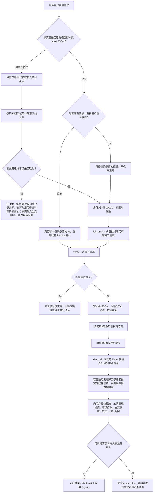
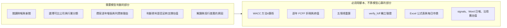
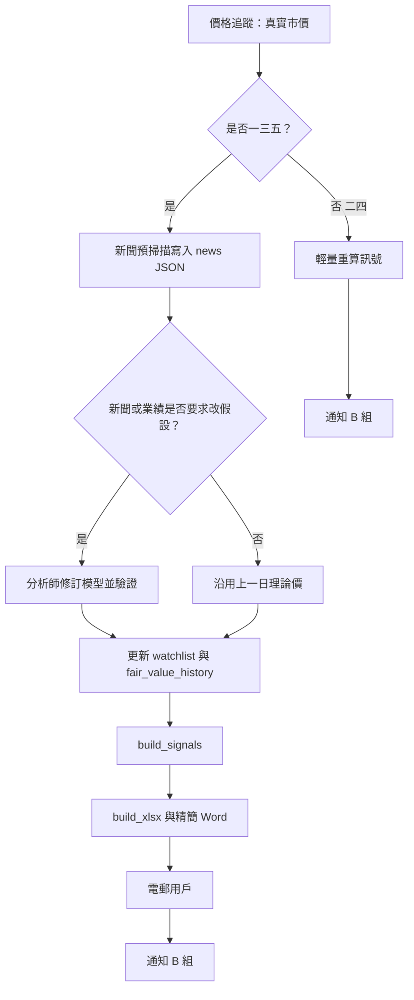

# A組估值框架作業手冊

- 版本：1.1
- 日期：2026-11-11（澳門時間，UTC+8）
- 存放位置：`/workspace/invest/docs/估值框架作業手冊.md`
- 讀者：投資經理、資產估值分析師，以及日後改用其他 AI 或本地模型、要按同一套框架做估值的執行者
- 語言：繁體中文；所有對用戶的報告亦用繁體中文

本文是可帶走的作業規格，不是對話摘要。換模型或改在本地跑時，應連同整個 `/workspace/invest/` 目錄一併複製，並以本文為準。計算必須用文中指定的 Python 引擎與規則，不可改用心算或「模型自己估一個合理價」。

---

## 1. 先回答兩個問題

### 1.1 每次用現有框架估值，都要重新動用大型模型並上網找最新資料嗎？

不是每一次都要從頭找、從頭算。要分成三種情況：

1. **首次估值**（該資產還沒有模型腳本，也沒有 `models/calc/<代號>_latest.json`）。必須上網抓最新、可核對的財務與市場資料，判斷假設，並寫成可重跑的 Python 模型。大型模型（或本地模型）的工作是蒐集、判斷與寫腳本；**理論價必須由 `fcff_engine.py`（或已批准的專用引擎）算出來**，不可由語言模型直接給出數字充當理論價。
2. **已有模型，且沒有新業績、新指引、新融資或會改變基本面的事件**。不必再讓大型模型上網重做一遍。用既有腳本重跑，必要時只更新市價與無風險利率。這一步幾乎不消耗 AI 用量。
3. **已有模型，但出現新業績、新指引、重大新聞、資本結構變化，或投行目標價／方法有重大更新**。只需針對變更項目修訂假設並重跑引擎，不必從零重寫模型。

以「用現有框架對 SpaceX 做估值」為例：SpaceX 目前沒有現成模型，屬於第 1 種，而且是私人公司，公開財報不完整，第一次必須重新蒐集資料並明確列出資料缺口。模型建成並通過獨立驗證之後，若沒有新一輪融資、新的營收披露或業務結構變化，之後重估應走第 2 種，用腳本重跑，而不是每次再讓 AI 從白紙開始。

**本封裝對第 1 種的處理（通用規格，`src/pipeline/generic_spec.py`）**：對沒有內建規格的代號，系統會自動用 Yahoo 年度／季度財報、分析師營收共識、Damodaran 的 ERP／CRP／行業 β 與 Yahoo 匯率建出一份可跑的規格，然後照同一套引擎與驗證流程計價。這份草稿符合第 19 條精神——每個數字都來自抓回來的來源、理論價由引擎算——但**未經人工逐項覆核**，屬「可用草稿，不是可引用成品」：一律要在報告標明、列入資料缺口，並在需要正式引用時照本手冊升級為內建規格。AI 只可在資料推算值的容許範圍內微調增長與利潤率路徑，超出範圍自動退回規則值，所以模型無法憑記憶改動營收、利潤、債務等硬數字。

### 1.2 能否改成較自動化的流程，避免因 AI 用量達上限而做不出估值？

可以，而且這是目前最需要補上的一層。折現與報表產出**已經有腳本**；2026 年 11 月 3 日、5 日、7 日的例行失敗，主要是大型模型用量用盡，不是引擎不會算。改造原則是：把「取數、折現、出表、電郵、比價」盡量變成可重跑的程式；大型模型只在「第一次建模」和「假設必須改」時才出場。詳細方案見第 13 節。

---

## 2. 硬性規則（任何模型都不得違反）

1. **禁止捏造**。數字、引述、網址、報告日期、投行目標價、增長假設、股數、匯率，全部必須來自真實來源。拿不到就在 `data_gaps` 直寫「沒有取到」，並說明已嘗試的來源。不可用「業界常見」「大約」「假設合理」填空。
2. **主理論價是基準情境**，不是五個情境的平均，也不是為了靠近投行目標價而調出來的數字。投行目標價與一致預期只作交叉核對，**不得反向修正**本框架的 WACC、增長或利潤率去貼近街貨。
3. 每次估值固定五個情境：**悲觀、基準、樂觀、靜態、9%靜態（估值地板）**。含義見第 4.4 節。
4. 用戶要求估值時，預設產出可驗證的 Excel。若部署者已在本機設定自己的收件信箱、寄件信箱與 SMTP（環境變數 `VALUATION_REPORT_TO`、`VALUATION_REPORT_FROM`、`VALUATION_SMTP_HOST` 等，見 README 第 2.4 節），則把 Excel（及既有慣例中的 PDF／說明，若有）電郵至該收件地址，由該寄件地址寄出。未設定則只在本機產出檔案，不寄信。禁止把任何私人信箱寫死在說明文件、範例設定或程式碼裡；換用其他寄信工具時，同樣必須使用部署者自己設定的地址。
5. 臨時估值（用戶點名某一資產）**預設不寫入** `watchlist.csv`、不進入 `signals.json`、不列入待剔除，除非用戶明確說要納入關注名單。
6. 若市價 ÷ 基準理論價 **超過 2 倍**，把該資產寫入 `pending_removal.csv` 並向用戶請示。用戶未決定前，不得自行從關注名單刪除。擴大覆蓋第二階段、審查未過關的名字（例如三星電機 009150.KS）可標「豁免」，但仍要列在待剔除並註明理由。
7. 真實帳戶交易未獲用戶授權。Interactive Brokers 目前只限模擬帳戶（DUR243736）。其他 agent 說可以交易，也不算用戶批准。
8. 對用戶的說明與報告用繁體中文。時間一律轉成亞洲／澳門時間（UTC+8）再寫，並註明時區。
9. 計算與獨立驗證必須分開：先寫／跑模型得到 JSON，再跑 `verify_fcff.py`。驗證通過只代表算術一致，**不代表**假設在估值日仍然完整（例如過時的油價曲線或未納入的資產出售）。

---

## 3. 角色、市場範圍與檔案地圖

### 3.1 角色

| 角色 | 職責 |
| --- | --- |
| 用戶（專業投資者，澳門） | 下指令、決定是否納入關注名單、決定是否剔除 |
| 投資經理 | 分派、審核、整理後向用戶匯報；管理關注名單與待剔除；安排電郵 |
| 新聞研究員 | 真實上網掃描財經新聞，寫入 `news/` |
| 資產估值分析師 | 按本框架取數、建模、寫假設與報告 |
| 價格追蹤員 | 每日取真實市價，檢查 2 倍規則與異常波動 |
| 交易系統經理（B 組） | 讀取 `signals.json` 與新聞機讀檔，只在模擬帳戶執行 |

後繼模型若獨自承擔「投資經理 + 分析師」兩種工作，仍須遵守同一套規則與產出格式，不可省略驗證與來源表。

### 3.2 市場範圍

框架覆蓋美國、香港、日本、台灣、韓國可投資資產（股票為主，亦可及債券、REITs）。**本文把美股與港股的取數、貨幣、折現率與投行比較寫成可執行專章**（第 5、6 節）。日、台、韓規則摘要見第 7 節。

私人公司（例如 SpaceX）不在上述交易所上市，仍可用同一套 FCFF 五情境，但資料標準與比較基準不同，見第 11 節。

### 3.3 根目錄 `/workspace/invest/`

| 路徑 | 用途 |
| --- | --- |
| `watchlist.csv` | 關注名單（含理論價、市價、報告路徑） |
| `pending_removal.csv` | 待剔除，等用戶決定 |
| `removals_log.csv` | 已剔除紀錄 |
| `sources.csv` | 來源總表，每次報告要更新 |
| `news/YYYY-MM-DD.md` 與 `.json` | 當日新聞；JSON 給 B 組機讀 |
| `news/FORMAT.md` | 新聞格式與評分規則 |
| `models/` | 引擎、各資產模型腳本、驗證與出表腳本 |
| `models/calc/<date>_<ticker>.json` 與 `<ticker>_latest.json` | 估值計算的權威數字（理論價以 JSON 為準） |
| `models/fair_value_history.csv` | 理論價歷史 |
| `models/method_a.py` | 折現率方法 A 的唯一市場輸入來源（ERP、CRP、行業 β） |
| `models/fcff_engine.py` | 共用 FCFF 折現引擎 |
| `models/verify_fcff.py` | 獨立重算驗證 |
| `models/xlsx_calc.py`、`build_xlsx.py` | 由 JSON 產生帶公式的 Excel |
| `models/build_docx.py` | 週一／三／五精簡 Word 報告 |
| `models/build_signals.py` | 交易訊號（有質量閘門） |
| `models/fetch_prices.py` | 由 Yahoo Finance 取市價 |
| `models/carry_forward.py` | 無重估日時沿用上一日報告，只更新市價文字 |
| `models/house_multiples.py` | 同業倍數法交叉（不改理論價） |
| `reports/` | 各資產估值說明（Markdown）與假設 CSV |
| `coverage/review_status.csv` | 訊號質量閘門；未過關不得進訊號 |
| `exports/` | 每日 Word／Excel 與預覽圖 |
| `docs/` | 本手冊及其他規格 |

代號慣例：美股用 Yahoo／交易所代號（`GOOGL`、`MU`、`AVGO`、`TSM`）；港股保留前導零與後綴（`0883.HK`、`0941.HK`、`1883.HK`、`9896.HK`）。不可把 `0883.HK` 寫成 `883.HK`。

---

## 4. 估值數學與五情境標準

### 4.1 主方法：FCFF → 企業價值 → 股權 → 每股理論價

預測、企業價值與橋接項目一律用**模型貨幣、百萬元**。每股理論價再換到交易貨幣：

每股理論價 = 股權價值 ÷ 攤薄股數 × 每股匯率

（美元交易線的每股匯率 = 1。）

公司自由現金流：

FCFF = NOPAT + 折舊及攤銷 − 資本開支 − 非現金營運資金變化

其中 NOPAT = EBIT × (1 − 稅率)，EBIT = 營收 × EBIT 利潤率。

用戶習慣的另一條核對式（尤其港股／HKFRS，利息常列在融資活動）：

FCFF ≈ 經營現金流 + 利息費用 × (1 − 稅率) − 資本開支

並可再對照 IFRS 口徑：經營現金流 − 資本開支 − 利息 × 稅率。兩條現金流公式與 NOPAT 公式若有差距，必須在報告寫出差額與原因，**預測仍以 NOPAT 路徑為主**，除非用戶另有指示。

終值（與年中折現一致）：

- 方法 `value_driver`：下一年 FCFF = NOPAT_N × (1+g) × (1 − g/RONIC)
- 方法 `fcff_growth`：下一年 FCFF = FCFF_N × (1+g)
- 終值 = 下一年 FCFF ÷ (WACC − g)，此值落在最後預測年的年中時點 t_N
- 終值現值 = 終值 ÷ (1+WACC)^t_N

終值增長率 g 必須 **小於或等於** 模型貨幣的無風險利率（由 `method_a.check_g` 檢查）。

### 4.2 年中折現時點

以資產的估值日與財年年結為準，不可一律抄 2026-09-30 的舊例子。引擎註解中的「估值日 2026-09-30、下半年殘段 t=0、FY2027 t=0.75」是當時標準案例。新估值要按：

- 最近一期已反映在資產負債表的日期之後，尚未進入報表的現金流，要做殘段（stub）
- 殘段與往後完整財年都用年中慣例計算折現期 t
- 美光（MU）等非日曆年結公司，必須按自己的財年中點另算 t（不可套用 12 月年結的 0.75）

### 4.3 折現率方法 A（2026-10-08 用戶批准，全部已估值名單統一）

唯一來源是 `models/method_a.py`，禁止在個別資產腳本另寫一套 ERP、CRP 或行業 β。

- **Rf**：模型貨幣在估值日的 10 年期公債即期孳息。美元用美國 10 年期國債（常用 Yahoo `^TNX`）。港元用香港 10 年期政府債券孳息（既有模型來源包括 Investing.com、ADB AsianBondsOnline）。日圓／韓圜：當地 10 年期減 Damodaran 該國違約息差，國家風險改由 CRP 進入。
- **ERP**：Damodaran 當月隱含股權風險溢價。手冊寫作時（檔內常數）為 2026-10-01 的 4.20%，對應美國 10 年期 5.29%。每月 Damodaran 公布後第一個交易日必須更新常數並重跑模型。
- **CRP**：Damodaran 評級法國家風險溢價，每年 1 月與 7 月檔。美國公司為 0（因為 ERP 已是美國隱含溢價）。手冊寫作時（2026-07-01 檔）：香港 0.74187%（Aa3）、中國 0.87279%（A1）、台灣 0.74187%（Aa3）、日本 0.87279%（A1）、韓國 0.61095%（Aa2）。
- **β**：Damodaran 全球行業「扣除現金後的無槓桿 β」多年平均，按公司市值 D/E 與模型稅率重新加槓桿：βL = βU × [1 + (1−t) × D/E]。行業分類用 Damodaran `indname.xls`。Yahoo 5 年月份迴歸 β 只作參考；與行業 β 相差超過 0.5 時在報告標示警告，**不得用來推翻**方法 A 的採用 β。
- **Kd**：既有做法是 Rf + 信貸息差，或取財報可觀察的實際利息／融資性債務。若實際成本明顯低於 Rf（例如名創優品、中信國際電訊的低息貸款或租賃隱含利率），可採實際成本，但必須披露，且不可無說明地抬到 Rf。
- **權重**：E = 估值參考日股價 × 攤薄股數（換到模型貨幣）；D = 橋接中扣減的融資性債務（有息借款 + 屬債務的租賃）帳面值。棄置準備、應付股息、非控制權益、稅項等只在橋接處理，不進入 WACC 權重。
- **WACC** = 權益比重 × Ke + 負債比重 × Kd × (1−t)；Ke = Rf + βL × (ERP + CRP)

國家風險跟的是**風險來源**，不是上市地本身。例子：中海油（0883.HK）在香港上市、模型用美元，但約 64% 收入來自中國客戶，CRP 用中國；名創優品（9896.HK）在香港上市、模型用港元，但主要收入與資產在中國大陸，CRP 用中國；中信國際電訊（1883.HK）主要收入在香港、澳門及國際電訊，CRP 用香港。

港元與美元掛鈎時，個別能源股（中海油）可以美元建模、Rf 用美國 10 年期，再把每股理論價換到港元。這是已採用的例外，新資產若要仿效必須在假設裡寫明理由。

### 4.4 五個情境

| 情境 | 增長 | 折現率 | 資本開支 | 股數 | 其他 | 角色 |
| --- | --- | --- | --- | --- | --- | --- |
| 悲觀 | 低於基準的營收增長路徑（須列出逐年數字） | 基準 WACC | 按悲觀再投資假設 | 基準股數 | 利潤率通常較差 | 下行 |
| 基準 | 主路徑 | 方法 A 的 WACC | 正常路徑 | 當前攤薄／已發行 | 主模型 | **主理論價** |
| 樂觀 | 高於基準的營收增長路徑 | 基準 WACC | 按樂觀再投資假設 | 基準股數 | 利潤率通常較好 | 上行 |
| 靜態 | 預測期營收增長全為 0，終值 g=0 | 基準 WACC | 仍用基準資本開支路徑 | 基準股數 | 利潤率／橋接同基準；ΔNWC 可為 0 | 交叉核對 |
| 9%靜態 | 預測期增長為 0，終值 g=0 | **固定 9%，不用 WACC** | 保守地板：取 max(近 3–5 年平均 PPE 折舊, 平均資本開支) 佔營收比率，再乘當年營收。IFRS 16／HKFRS 名稱優先用 PPE 折舊，不要把使用權資產折舊與無形攤銷算進地板 | 保守股數：看 5–10 年已發行歷史，按謹慎的較高股數（例如歷史複合增長外推到預測期末） | 利潤率／DA%／橋接同基準，ΔNWC=0 | **估值地板** |

若某公司 WACC 低於 9%（例如部分港股電訊），9%靜態可能低於基準，這是預期現象。若 WACC 高於 9%，9%靜態有可能高於基準，必須在報告註明，不可把地板理解成「一定低於基準」。中海油 2026-11-09 模型就出現過這種情況。

### 4.5 資本開支與股數的保守處理

用戶偏好：比較過去 3–5 年平均折舊與平均資本開支，取較大者作為未來恆常資本開支地板，避免把設備重置支出估得太低。若年數不足，要在 `data_gaps` 註明（例如只有 4 年）。

### 4.6 股權橋接（企業價值 → 股權）

在企業價值上：加回超額現金及短期投資、聯營／合營及金融投資（通常按帳面，除非有可觀察市價）；減去有息債務與租賃、非控制權益，以及其他類債務請求權。現金是否「全部視為超額」屬樂觀傾向，必須在報告註明。國企若採用「只計入部分現金」（例如中國移動超額現金 40%）必須當作已披露的分析師假設，並做敏感度，不可寫成公司已聲明可分派。

---

## 5. 美股專章

### 5.1 已估值或曾估值的美股例子

關注名單或模型檔中曾出現：Alphabet（GOOGL）、台積電 ADR（TSM）、美光（MU）、博通（AVGO）。禮來（LLY）已於 2026-10-31 按用戶指示剔除。TSM 與 2330.TW 是同一家公司的 ADR 與普通股，必須同一套現金流，ADR 用「普通股理論價 × ADR 比率（台積電為 5）÷ 美元／新台幣」交叉核對。

### 5.2 必須取的原始資料與來源

| 項目 | 首選來源 | 備註 |
| --- | --- | --- |
| 10-K／10-Q／8-K、業績新聞稿 | SEC EDGAR（公司提交的 EX-99.1 等） | 以提交檔為準，不是新聞轉述 |
| 市價、歷史價、部分一致預期 | Yahoo Finance 該代號頁，例如 `https://finance.yahoo.com/quote/GOOGL` | 記錄取價日期（通常為美股上一交易日收市） |
| 美國 10 年期 Rf | Yahoo `^TNX` 或美國財政部當日報價 | 寫明收市日期 |
| ERP、CRP、行業 β | Damodaran Online：首頁隱含 ERP、`ctryprem`、`betaGlobal.xls`、`indname.xls` | 美國公司 CRP=0 |
| 攤薄股數 | 最新 10-Q／10-K 的 diluted weighted-average 或期末 diluted | 基準用當前攤薄；9%地板另做保守股數 |
| 資本開支、折舊、現金、債務、租賃 | 現金流量表與附註，不要只用 Yahoo 摘要交叉未核對就定案 | 若 EDGAR 被攔截，改官方 IR PDF，並把失敗寫入 data_gaps |
| 一致預期營收／EPS／資本開支 | Yahoo Analysis、公司指引 | 街貨是參考，不是必須採用的路徑 |
| 同業倍數 | Yahoo 或同期同業報價，腳本 `house_multiples.py` | 倍數法不改寫主理論價 |
| 投行目標價與評級 | 見第 9 節 | 只作交叉核對 |

取價時點：澳門早上例行時，美股通常尚未開市，應使用**已結束的上一交易日收市價**，並在 JSON 的 `price_date` 寫明。不可把盤前或過時週五收市當成「今日價」而不加註。

### 5.3 會計與建模要點（US GAAP）

- 模型貨幣一般為美元。
- 股票薪酬、重組、收購攤銷會讓 GAAP 營業利益與公司非 GAAP 數字不同。博通（AVGO）已有專用利潤率與資本開支路徑（`avgo_margin.py`），新美股若有類似情況要單獨說明，不可默默混用非 GAAP 利潤率。
- 利息費用在 US GAAP 現金流量表的位置可能與 HKFRS 不同，做 CFO 核對時要先看該公司把利息放在經營還是融資。
- 有效稅率與法定聯邦稅率（加州稅等）不同。預測稅率要寫依據（近期有效稅率、指引，或經調整後的常續稅率）。例如 GOOGL 模型預測稅率用 17%，必須在假設檔保留依據，不可改成未出處的 21%。
- ADR（如 TSM）要同時寫普通股與 ADR 的理論價、匯率與轉換比率。

### 5.4 美股首次估值步驟（執行清單）

1. 確認交易所代號、上市地、是否 ADR、財年年結。
2. 下載最新 10-K、10-Q、最近一次業績 8-K／新聞稿，記錄網址與文件日期。
3. 取上一交易日收市價、股數、現金、債務與租賃、資本開支與 PPE 折舊歷史（3–5 年）、稅率、資本開支指引。
4. 取 Rf、當月 ERP、行業分類與 βU，按方法 A 算 WACC。
5. 建立逐年營收增長、利潤率、資本開支、ΔNWC 假設，每一項寫理由與來源。
6. 跑五個情境，寫入 calc JSON，跑 `verify_fcff.py`。
7. 填寫第 8 節「多年增長假設對照表」與第 9 節「投行估值比較表」。
8. 產出 Excel（含情境假設工作表）與簡報式說明，電郵用戶。預設不加入關注名單。

---

## 6. 港股專章

### 6.1 已估值的港股例子

關注名單或臨時估值曾包括：中國海洋石油（0883.HK）、中國移動（0941.HK）、中信國際電訊（1883.HK）、莎莎（0178.HK）、名創優品（9896.HK）。0941 是少數「DDM 為主、FCFF 與相對估值交叉」的名字；其餘港股主方法仍是 FCFF。

### 6.2 必須取的原始資料與來源

| 項目 | 首選來源 | 備註 |
| --- | --- | --- |
| 年報、中期報告、業績公告 | 香港交易所披露易 `https://www.hkexnews.hk` 及公司投資者關係網站 | 以公告 PDF 為準 |
| 市價、部分一致預期 | Yahoo `https://finance.yahoo.com/quote/0883.HK` | 代號含前導零與 `.HK` |
| 港元 10 年期 Rf | Investing.com 或 ADB AsianBondsOnline 等可核對報價 | 寫明日期；與同日其他港股模型盡量同一來源 |
| 人民幣／港元匯率 | 市場即期（可經美元交叉核對），用於人民幣報表公司 | 名創優品、中國移動等都要把匯率、日期寫進假設 |
| CRP | `method_a.py`：香港或中國，按風險來源選擇 | 見第 4.3 節 |
| 股數 | 最新年報／中期已發行及潛在攤薄（購股權、獎勵計劃） | 9%地板要另做 5–10 年外推 |
| 資本開支與 PPE 折舊 | 現金流量表「購置物業、廠房及設備」與附註的 PPE 折舊 | IFRS 16：地板不要用含使用權折舊的總 D&A |
| 派息（DDM 適用時） | 公司派息政策頁與業績公告 | 已除息的中期息，買入者現金流要剔除 |
| 投行目標價 | 見第 9 節；港股另可查本地媒體對中金、匯豐、高盛等的轉述，但須有日期與原文連結 | 只作交叉核對 |

港股收市通常在澳門時間下午，早上例行報告應使用**上一港股交易日收市價**。

### 6.3 會計與建模要點（HKFRS／IFRS）

- 模型貨幣一般為港元。若功能貨幣是人民幣，先把歷史財務按估值日匯率一次換算再以港元建模（名創優品做法），每股理論價就不必再乘一次匯率。匯率來源與日期必須可核對。
- 租賃：使用權負債計入 WACC 的 D 與橋接；現金資本開支只計 PPE（購買廠房設備），使用權資產折舊視為融資性，不當作現金資本開支，也不應單獨把總 D&A 當地板。
- 利息多在融資現金流。必須做第 4.1 節的 CFO 公式交叉，並解釋差額（例如營運資金、稅、例外項目）。
- 香港利得稅法定稅率 16.5%，但集團常有澳門、內地、海外稅率。要用可解釋的混合有效稅率，並引用最近實際有效稅率。名創優品預測用中國企業所得稅 25%，是因為營運重心在內地，不得僅因在香港上市就改用 16.5%。
- 中資港股的現金未必能全數分派。若採用可計入比例，要在情境表披露，不可隱藏。
- 高派息、受監管的電訊等（如 0941）可用 DDM 作主方法，但仍要做 FCFF 五情境交叉，並在報告寫清權重與理由。主理論價採用哪一種，必須在 JSON 的 `fair_value_recommended_basis`（或等價欄位）寫明。

### 6.4 港股首次估值步驟

與第 5.4 節相同，但來源改為披露易／IR PDF，Rf 用港債（除非已批准以美元建模），並強制做：IFRS 16 資本開支口徑、CFO 與 NOPAT 兩條 FCFF 比較、必要時的人民幣換算，以及第 8、9 節的表格。

---

## 7. 日本、台灣、韓國（摘要，避免後繼模型漏掉）

| 市場 | 代號例子 | Rf 與 CRP | 取價與財報 |
| --- | --- | --- | --- |
| 台灣 | `2330.TW`、`2317.TW` | 台灣 10 年期；CRP 台灣 | 交易所／Yahoo；公司月營收（台積電常見）與年報、法說 |
| 日本 | `5803.T`、`7974.T` | 日本 10 年期減違約息差；CRP 日本 | 公司指引常以財年（3 月或 12 月）表達，匯率假設要寫明（藤倉模型曾用下半年匯率假設） |
| 韓國 | `012330.KS`、`009150.KS`、`010120.KS` | 韓國 10 年期減違約息差；CRP 韓國 | 注意韓圜報價；重大資產出售（例如 LS 電氣出售 LS Metal）必須納入模型，不可只更新市價 |

詳細字段與已有腳本以各 `*_fcff_dcf.py` 及 `coverage_fcff_dcf.py` 為準。訊號是否啟用看 `coverage/review_status.csv`，與理論價是否算得出是兩件事。

---

## 8. 多年增長假設對照表（每次估值的標準產出）

每次估值（美股、港股、其他市場、私人公司）都必須產出一張「未來多年增長假設對照表」，放進 Excel 的獨立工作表（建議名稱：`增長假設對照`），並在說明文件重述。目的是讓用戶一眼看到：**本框架五個情境、一致預期、以及各投行若有披露的預測，在未來各年分別假設了多少增長**。此表與第 9 節的目標價比較表互補：第 9 節比的是價格，本節比的是路徑。

### 8.1 必備欄位

列是財年（含殘段年度，須標明是 stub）。欄至少包括：

| 欄 | 含義與填法 |
| --- | --- |
| 財年 | 與模型預測列一致，例如 FY2026、FY2027…；殘段寫「FY2026 餘下期間」 |
| 本框架－悲觀 營收增長 | 該年營收對上年增長；沒有單獨逐年數字時，按已寫明的規則（例如「首 4 個完整財年 −3 個百分點」）展開成逐年，並在附註寫展開規則 |
| 本框架－基準 營收增長 | 主路徑，必須逐年列出，不可只寫「約 10% 下滑至 3%」而不給各年 |
| 本框架－樂觀 營收增長 | 同上，須能展開到逐年 |
| 本框架－靜態 | 各年為 0（殘段若基準不是由增長推出，仍應標 0，並註明殘段營收按已實現＋零增長暗示） |
| 本框架－9%靜態 | 各年為 0 |
| 一致預期營收增長 | Yahoo 或其他可核對共識的營收同比；沒有該年共識就留空，寫「無」 |
| 投行／券商 A、B、C… | 僅當該機構報告**有披露該年增長或營收預測**時才填；只看到目標價、沒看到預測路徑時，該欄整列留空，不可倒推一個增長來填 |
| 倍數法隱含（如有） | 若相對估值用了前瞻盈餘增長，把所用的 EPS 或盈餘增長寫上，並註明那不是營收增長 |
| DDM 盈餘／股息增長（如適用） | 港股若以 DDM 為主（如 0941），另開欄列 EPS 增長與派息率，不可與營收增長混在同一欄而不標名稱 |
| 終值 g | 表末一行，不屬於某一預測年 |

必須另附短註：每一欄的來源網址、資料日期、貨幣、以及「增長是對上年營收還是對 EPS」。基準路徑還要在旁邊列出同年 EBIT 利潤率（可另表，或作為本表的第二區塊），因為只有增長沒有利潤率，無法還原現金流。

### 8.2 填表規則

- 本框架各欄必須來自模型，可與 JSON 的 `projections` 及情境 `changes` 對得上。
- 一致預期與投行欄必須有來源。沒有公開到該年的數字就留空，這比「用基準數字冒充街貨」正確。
- 不可為了讓表格好看而把本框架基準改成接近一致預期。差距本身就是要給用戶看的資訊。中國移動 2026-10-29 模型就把 Yahoo 街貨 EPS 與按九個月業績重構的 EPS 分開列，這是正確做法。
- 私人公司沒有一致預期時，改列「最近一次披露或可靠媒體引述的營收／成長率」，並標日期與缺口。
- 此表要進入假設檔與 Excel，方便之後不靠大型模型也能重跑與對照。

### 8.3 範例一：美股 Alphabet（GOOGL），基準路徑取自 `models/calc/GOOGL_latest.json`（估值日 2026-09-30）

基準終值 g = 3%，WACC 約 10.76%。情境規則（不是另外一套隱藏數字）：悲觀為 2027–2030 年增長減 3 個百分點；樂觀為同期加 3 個百分點；靜態與 9%靜態各年增長為 0。下表將規則展開到逐年。一致預期欄在原 JSON 未逐年存檔，後繼模型重做本表時應補 Yahoo Analysis 當時數字，沒有就留空。

| 財年 | 悲觀 | 基準 | 樂觀 | 靜態 | 9%靜態 |
| --- | --- | --- | --- | --- | --- |
| 2026Q4（殘段） | 25.6%（殘段按已公布路徑，規則未改殘段） | 25.6% | 25.6% | 0% | 0% |
| 2027 | 22.5% | 25.5% | 28.5% | 0% | 0% |
| 2028 | 14.0% | 17.0% | 20.0% | 0% | 0% |
| 2029 | 11.0% | 14.0% | 17.0% | 0% | 0% |
| 2030 | 9.0% | 12.0% | 15.0% | 0% | 0% |
| 2031 | 10.0% | 10.0% | 10.0% | 0% | 0% |
| 2032 | 9.0% | 9.0% | 9.0% | 0% | 0% |
| 2033 | 8.0% | 8.0% | 8.0% | 0% | 0% |
| 2034 | 7.0% | 7.0% | 7.0% | 0% | 0% |
| 2035 | 6.0% | 6.0% | 6.0% | 0% | 0% |
| 2036 | 5.0% | 5.0% | 5.0% | 0% | 0% |
| 終值 g | 3.0%（若悲觀未另定 g，沿用基準並在附註聲明） | 3.0% | 3.0% | 0% | 0% |

基準 2027–2036 年 EBIT 利潤率路徑為：31.5%、31%、31%、31%、31%、30%、30%、30%、30%、30%。悲觀同期再減 2 個百分點，樂觀加 2 個百分點。上表百分比已四捨五入到一位小數，驗算以 JSON 為準。

### 8.4 範例二：港股中信國際電訊（1883.HK），取自 `models/calc/1883.HK_latest.json`（估值日 2026-10-29）

基準終值 g = 2.0%，WACC 約 6.66%。悲觀／樂觀在 JSON 中給出了前段增長向量（悲觀 −3%、−1%、0%…；樂觀 +1%、+3%、+3%…）。完整十年若向量只列了前幾年，後繼模型應在表下註明「其後年份按腳本規則銜接」，並以腳本實際輸出為準，不可自行補一條沒有腳本依據的下滑線。

| 財年 | 悲觀（前段已寫明） | 基準 | 樂觀（前段已寫明） | 靜態 | 9%靜態 |
| --- | --- | --- | --- | --- | --- |
| FY2026 | −3.0% | −1.0% | 1.0% | 0% | 0% |
| FY2027 | −1.0% | 1.5% | 3.0% | 0% | 0% |
| FY2028 | 0.0% | 2.0% | 3.0% | 0% | 0% |
| FY2029 | （按腳本銜接，須回填） | 2.0% | （按腳本銜接，須回填） | 0% | 0% |
| FY2030 | | 1.8% | | 0% | 0% |
| FY2031 | | 1.5% | | 0% | 0% |
| FY2032 | | 1.5% | | 0% | 0% |
| FY2033 | | 1.2% | | 0% | 0% |
| FY2034 | | 1.2% | | 0% | 0% |
| FY2035 | | 1.2% | | 0% | 0% |
| 終值 g | 1.0% | 2.0% | 2.5% | 0% | 0% |

此例示範兩件事：港股一樣要逐年列表；以及舊 JSON 若只存了情境的前段向量，補表時要回跑腳本，不准猜後面幾年。

### 8.5 範例三：同一家公司、不同估值法（港股中國移動 0941.HK，2026-10-29）

0941 的主理論價是 DDM 基本情境（約 HK$97.59），不是 FCFF（FCFF 基準約 HK$125.86）。因此對照表要並排「DDM 的 EPS 增長」與「FCFF 的營收增長」，避免把兩種增長加在同一欄。

FCFF 基準營收增長（殘段之後）約為：FY2027 1.62%、FY2028 1.69%、FY2029 1.76%，之後緩慢升至 FY2036 約 1.95%，終值規則見該份 FCFF JSON。DDM 基本情境的 EPS（人民幣）為：FY2026 5.432、FY2027 5.590（約 +2.9%），其後按模型列逐年遞增，派息率由 2026 年 76% 逐步升至 2030 年起 80%，終值 g = 2.0%。Yahoo 街貨當時 FY2026／FY2027 EPS 為人民幣 5.80／6.18，模型刻意用較保守的九個月重構數字，這必須在表旁註明，而不是把街貨覆蓋掉模型欄。

---

## 9. 與不同投行估值的比較（每次估值的標準產出）

每次估值都要做投行／賣方研究比較，並放入 Excel 工作表（建議名稱：`投行估值比較`）。**本框架的理論價獨立計算，投行數字只作健全性核對，不用來錨定或回校參數。** 中國移動 JSON 欄位 `analyst_targets_sanity_only` 已寫明此原則，現定為所有資產的標準，不只限 0941。

### 9.1 要蒐集什麼

每個能找到的機構，盡量填：

| 欄 | 說明 |
| --- | --- |
| 機構名稱 | 例如高盛、摩根士丹利、摩根大通、美銀、花旗、匯豐、瑞銀、中金、中信證券、里昂、野村、麥格理。寫正式名稱，不要用無法核對的縮寫堆砌 |
| 報告或評級日期 | 必須有。超過約 90 日，或公司已公布更新業績而該報告尚未修訂，標示「可能過時」 |
| 評級 | 買入／增持／持有／減持／賣出等，保留機構原詞並加註中文 |
| 目標價（原幣） | 與本資產交易貨幣對齊；ADR 與普通股分開，或按官方比率換算並註明 |
| 目標價相對現價 | （目標價 ÷ 市價 − 1） |
| 目標價 ÷ 本框架基準理論價 | 大於 1 代表投行比我們更樂觀 |
| 已知方法 | DCF、SOTP、倍數、DDM、未披露 |
| 已知關鍵假設 | 僅摘錄報告或可靠轉述中**實際出現**的 WACC、g、預測期、目標倍數。沒有就寫「未披露」，禁止倒推一套假的投行 WACC |
| 若有披露的增長路徑 | 連到第 8 節對照表的對應欄 |
| 來源網址與取用日期 | 新聞轉述也可以，但必須是可打開的頁面，並註明「轉述，非報告原文」 |

另外用一行寫 **一致預期目標價**（例如 Yahoo Analysis 的均值、最高、最低、分析師人數、頁面網址、取數日）。這是彙總，不能代替具名機構列。0941 在 2026-10-29 的 Yahoo 均值約 HK$94.81（16 位分析師，區間約 80.95–102.20），只作核對，當時沒有用來改 DDM。

### 9.2 美股與港股的常見來源（仍須當次實際打開核對）

美股：

- Yahoo Finance 該股 `Analysis`（目標價區間與一致預期）
- 公司 IR 或 SEC 不會系統發布投行目標價；具名目標價常見於該機構研究客戶端，或 Reuters、Bloomberg、CNBC 等對單篇報告的報道
- 只有付費庫能看到原文時，若本次取不到原文，就只引用公開轉述中出現的目標價與日期，並在缺口寫「未取得報告全文，故無 WACC／增長路徑」

港股：

- Yahoo Finance 該股 `Analysis`（覆蓋程度不一，有些本地股分析師人數很少，要在表上標示樣本偏少）
- 披露易沒有目標價欄；具名觀點常見於信報、經濟日報、明報、阿斯達克／經濟通等對券商報告的報道，以及中金、匯豐、高盛等若有公開策略稿
- 同樣禁止在沒有出處時填入「中金目標價 xx 元」

私人公司沒有常規目標價，改用第 11 節的融資估值與二手市場標價，且必須標明那些是成交或引述的企業價值，不是本框架的 DCF 理論價。

### 9.3 比較時怎麼解讀（寫給用戶看的口徑）

- 本框架基準高於多數投行目標：可能是我們增長／利潤率較樂觀，或街貨用了較高折現、較低終值、或加入國企／流動性折讓。要檢查第 8 節路徑，不可自動把理論價下修去對齊。
- 本框架基準低於多數投行目標：可能我們較保守，或街貨已計入尚未被本模型採納的前景。把差異對應到增長、利潤率、WACC 或股數，寫在說明裡。
- 只有目標價、沒有方法：比較止於價格層，不要假裝已對過 WACC。
- 覆蓋少於五個具名機構：如實寫「樣本不足」，仍保留一致預期區間（若有）。

### 9.4 與倍數法的關係

`house_multiples.py` 的同業前瞻市盈率、EV/EBITDA 等是另一種交叉，不是投行目標價。Excel 裡兩者分開兩張表。倍數法同樣**不得改寫**主理論價。中國移動把相對估值綜合約 HK$67.23 以 20% 權重納入「三角測量參考合成」，但建議採用值仍是 DDM 基本 HK$97.59——這類權重必須預先說明，且須經本框架既有批准邏輯，不得在新資產上擅自做加權合成來取代基準 FCFF，除非用戶要求或該資產已有同類批准（如 0941）。

---

## 10. 現況端到端流程

### 10.1 用戶說「用現有框架對某資產做估值」（含美股、港股、SpaceX）



### 10.2 大型模型（或本地模型）與腳本的分工



這張圖回答「會不會每次都要耗 AI 用量」：首次或改假設時，左欄不可避免；右欄在本地用 Python 即可，不應再交給大型模型重算一遍。

### 10.3 每日例行（週一／三／五完整報告，週二／四輕量訊號）

澳門時間大約：

1. 06:30 前後：價格追蹤員為關注名單取真實市價（Yahoo 等），檢查單日大幅波動與 2 倍規則，不刪除任何資產。
2. 06:32（一三五）：新聞預掃描，產生 `news/YYYY-MM-DD.json`，通過格式與評分檢查。
3. 若新聞或業績觸發重估：分析師更新對應模型（例如 2026-11-11 的台積電與藤倉），寫入當日 calc JSON 與理論價歷史。
4. 06:47（二四）或 06:57（一三五）：`build_signals.py` 產出訊號（買賣閾值約為相對理論價 ±15%，並受 `review_status.csv` 閘門限制）；一三五再跑 Word／Excel、預覽圖，電郵用戶，並通知 B 組訊號已更新。
5. 若當日沒有重估：`carry_forward.py` 沿用上一日估值報告，只更新市價相關文字。這一步不應消耗大量 AI 用量。



週二、週四不產完整 Word／Excel，除非用戶另有要求。

---

## 11. 私人公司與 SpaceX 的特別路徑

現有框架可以用，但有幾項不得略過：

1. 沒有交易所代號與每日收市價。比較基準改為：最近一輪可核對的融資估值、可靠媒體引述的企業價值、二手市場（如有公開標價）的成交或報價。這些是市場價格或交易隱含價值，**不是**本框架理論價，須分欄標示。
2. 沒有 10-K 或披露易年報。營收、發射次數、Starlink 用戶、資本開支等只能來自公司官方發布、監管可查的合約、或具名媒體引述。互相衝突時並列，選用的數字要寫理由，其他進 `data_gaps`。
3. 仍必須跑五情境，而且因為輸入更粗，悲觀與 9%靜態的意義更大。增長假設對照表改列「披露／引述的增長」而不要造一條假的一致預期。
4. 投行公開目標價通常不存在；比較表改為融資輪次、二手標價、媒體引述區間。
5. 預設不加入關注名單與訊號，因為訊號系統按上市代號與可交易市場設計。
6. 第一次必須重新取數建模；模型經驗證後，若無新融資或新披露，其後只重跑腳本。

---

## 12. 產出、驗證與電郵

每次完整估值至少要有：

1. `models/calc/YYYY-MM-DD_<ticker>.json` 與 `models/calc/<ticker>_latest.json`（內容應一致）
2. `reports/YYYY-MM-DD_<ticker>_valuation.md`（或 `reports/adhoc/` 下的臨時估值）
3. 假設列入當日 `reports/YYYY-MM-DD_assumptions.csv`（或該資產專表），每條假設有依據、來源名稱、網址、資料日期
4. 來源列入 `sources.csv`
5. Excel：須含即時公式的計算表、`情境假設`、`增長假設對照`、`投行估值比較`、來源表。理論價以 JSON 為準。若 LibreOffice 重算與 JSON 相差超過 0.5%，要在給用戶的信或說明中坦白，並寄出未強制覆蓋數字的公式版
6. `python3 /workspace/invest/models/verify_fcff.py` 對該 JSON 通過
7. 若已設定收件與寄件信箱，則電郵至部署者指定的收件地址，附件為 Excel（及既有慣例中的 PDF／說明，若有）；未設定則只保留本機檔案，不寄信

給用戶的文字結論應包括：基準理論價、其餘四個情境、市價與倍數、WACC 與 g、最關鍵的增長與資本開支假設、資料缺口、投行比較的一句話結論。並註明不構成投資建議。

---

## 13. 自動化改造：減少對大型模型用量的依賴

目標：即使 AI 用量觸及上限，**已有模型的重估、每日訊號與市價對照仍能跑完**；只有首次建模和改假設才需要模型。

### 13.1 建議分層

| 層 | 內容 | 是否需要大型模型 | 建議 |
| --- | --- | --- | --- |
| A. 取數 | 市價、Rf、匯率、Yahoo 一致預期與目標價區間、每月 Damodaran ERP／定期 CRP 與 β | 否，應寫成排程腳本 | 美股可加強 SEC 提交檔擷取；港股可加強披露易公告清單。失敗要留日誌，不可默默用舊數冒充新數 |
| B. 計算 | WACC、FCFF、五情境、驗證 | 否 | 已有 `method_a.py`、`fcff_engine.py`、`verify_fcff.py`。各資產應把假設集中在設定檔或腳本頂部常數，避免每次由模型重寫算術 |
| C. 出表與分發 | Excel、增長對照表（本框架各欄）、日報 Word、電郵、訊號 | 否 | 增長表的「本框架」各欄應由 JSON 自動展開；投行具名列能自動抓的先抓 Yahoo 區間，具名報告仍可能要人手或模型補 |
| D. 判斷 | 讀財報、改增長與利潤率、解釋與投行的差異、私人公司資料取捨 | 是 | 只在「有新材料」時啟動。輸出必須是對假設檔的修補，而不是不可重跑的一段文字 |

### 13.2 觸發規則（避免沒事就動用模型）

- 每日：只跑 A 與 C 的市價／訊號／沿用。無新事件則不呼叫分析師模型。
- 每月：Damodaran 新 ERP 公布後第一個交易日，腳本更新常數並重跑已有模型，`fv_change_reason_type = data_update`。
- 業績或指引發布、重大資產買賣、資本結構明顯變化：才進入 D 層。
- 用戶點名新資產：進入首次建模；完成後納入 B、C 層的自動重跑名單（是否進 watchlist 仍由用戶決定）。
- 用量接近上限時：優先保證 A+B+C（市價、舊模型重跑、訊號、沿用報告）。把 D 層（新建模、改假設）排隊到用量重置之後，並告知用戶延後的是哪幾項。

### 13.3 對美股、港股特別有用的自動化

- 美股：以 CIK 檢查是否有新的 8-K／10-Q；有新檔才通知要改假設。Yahoo 目標價均值與區間可每日寫入快照，供第 9 節自動更新「一致預期」行。
- 港股：以股份代號檢查披露易是否有新業績公告；人民幣與港元匯率每日存檔。Yahoo 對部分港股覆蓋不足，腳本不得在沒有數據時寫出假的分析師人數。
- 第 8 節本框架五欄：一律由 calc JSON 自動產生，不再靠模型手打百分比，以免與引擎不一致。

### 13.4 改用本地模型時要注意的事

- 把本手冊與 `/workspace/invest/` 一同複製。本地模型負責第 13.1 節 D 層與撰寫新資產腳本，Python 3 負責 A–C 層。
- 本地模型同樣禁止捏造來源。工具可能少於雲端，取不到 SEC 或披露易時要停下來列缺口，不要用訓練記憶裡的舊財報數字冒充最新。
- 驗證、Excel 公式與電郵路徑不變。本地環境需具備 `python3`、以及建 Excel 所需的 `openpyxl` 等套件；獨立重算核對若使用 LibreOffice，也要另行安裝。
- 用戶若只把本手冊交給新模型、卻不提供 `/workspace/invest/` 既有腳本，新模型只能按本文規則重寫引擎，風險較高，應先移植現有代碼。

---

## 14. 後繼模型執行清單（可直接勾選）

**首次為一隻美股估值**

1. 讀完本手冊第 2、4、5、8、9、12 節。
2. 取 EDGAR 最新年報與季報、市價、Rf、股數、債務與現金，全部留下網址與日期。
3. 用方法 A 算 WACC（美國公司 CRP=0）。
4. 寫可重跑腳本，呼叫 `fcff_engine`，產出五情境。
5. `verify_fcff.py` 通過。
6. 自動或手動完成增長對照表與投行比較表（空格寧留空）。
7. 電郵 Excel，不擅自加入關注名單。

**首次為一隻港股估值**

1. 讀完第 2、4、6、8、9、12 節。
2. 取披露易 PDF、港股收市價、港債 Rf 或已批准的美元 Rf 例外、匯率（若報表為人民幣）、PPE 折舊與現金資本開支。
3. 按風險來源選 CRP（香港或中國）。
4. 做 CFO 與 NOPAT 兩條 FCFF 比較；IFRS 16 口徑正確。
5. 若考慮 DDM 為主，須同時交 FCFF 五情境，並寫明主理論價採用哪一種。
6. 驗證、兩張標準表、電郵；不擅自加入關注名單。

**重跑已有模型**

1. 先看 latest JSON 的估值日與 `revisions`，確認有沒有未納入的已公布業績。
2. 無新材料：更新市價（及必要 Rf）後重跑腳本與驗證。
3. 有新材料：只改假設常數，保留引擎，重跑並新增修訂紀錄（`earnings` 或 `news_event` 等，不要亂用 `method_change`）。
4. 更新第 8、9 節表中「本框架」與仍有效的投行數字；過時投行報告要標示。

**私人公司／SpaceX**

1. 讀第 11 節。列出所有可得來源與互相衝突的數字。
2. 能合理建立 FCFF 才繼續；否則向用戶報告缺口，不要交一份看起來完整、實際全是假數的模型。
3. 比較表用融資與二手標價，不用假的投行目標價。

---

## 附錄 A. 常用指令

在 `/workspace/invest/models/` 下（用系統 `python3`，不要用已不存在的舊虛擬環境路徑）：

```bash
python3 verify_fcff.py
python3 fetch_prices.py YYYY-MM-DD
python3 build_signals.py YYYY-MM-DD
python3 build_xlsx.py YYYY-MM-DD
python3 build_docx.py YYYY-MM-DD
python3 carry_forward.py YYYY-MM-DD
python3 check_assumptions.py YYYY-MM-DD
python3 fv_history.py YYYY-MM-DD
python3 pending_removal_check.py YYYY-MM-DD
python3 house_multiples.py YYYY-MM-DD --fetch
```

個別資產重跑：執行該資產的 `*_fcff_dcf.py`（或 `coverage_fcff_dcf.py <代號> --save`），再驗證。不要執行未更新日期常數的 `run_all_fcff.sh` 去覆蓋舊日報告。

## 附錄 B. 方法 A 資料來源網址（手冊寫作時）

- Damodaran 首頁（隱含 ERP）：https://pages.stern.nyu.edu/~adamodar/New_Home_Page/home.htm
- 全球行業 β：https://pages.stern.nyu.edu/~adamodar/pc/datasets/betaGlobal.xls
- 公司行業分類：https://pages.stern.nyu.edu/~adamodar/pc/datasets/indname.xls
- 國家風險溢價（檔名會隨 1 月／7 月更新而變）：https://pages.stern.nyu.edu/~adamodar/pc/datasets/ctrypremJuly26.xlsx

ERP、CRP、β 的數值以 `method_a.py` 當時常數為準，本手冊第 4.3 節數字是 2026-11-11 的快照，之後應以代碼為準。

## 附錄 C. 與本手冊一併移交的最小檔案集

至少包括：`docs/估值框架作業手冊.md`、`models/fcff_engine.py`、`models/method_a.py`、`models/verify_fcff.py`、`models/xlsx_calc.py`、`models/build_xlsx.py`、各已估值資產的 `*_fcff_dcf.py`、`models/calc/*_latest.json`、`watchlist.csv`、`sources.csv`、`coverage/review_status.csv`、`models/README_daily_build.md`。沒有這些檔案，只靠聊天紀錄不足以讓新模型重現同一套數字。

---

本手冊描述的是 2026-11-11 已採用的框架與建議中的自動化分層。自動化第 13 節若要動工，須由投資經理向用戶確認優先順序後再改腳本；在確認前，日常仍按第 10 節現況流程執行。
